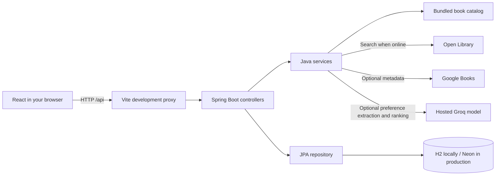

# Learn Book Buddy by following a request

You do not need to memorize this project. Pick a feature, find its entry point, and follow the values. Predict the result before running it. Then change something small and explain what changed.

## 1. The pieces and their jobs



React controls what you see. Java receives requests, checks permission and input, and decides what data to return. JPA translates repository operations into database work. H2 stores local data; the deployed production profile uses Neon PostgreSQL. Open Library and optional Google Books supply public metadata; they do not store your shelf.

In development, React is served on port 5173 and Java on port 8080. `vite.config.js` forwards requests beginning with `/api`. That is why React can call `/api/shelf` without writing a different host into every request. The ordinary launcher instead serves the compiled React app directly from Spring on port 8080, requiring just one Java process.

## 2. Start by loading a shelf

1. Open `frontend/src/App.jsx`. Find the initial loading effect and the call that loads the signed-in user.
2. Follow its API call into `frontend/src/api.js`. Note the URL and how it handles a non-200 response.
3. Follow `GET /api/auth/me` into `AuthController.java`. A session cookie identifies an already signed-in reader. An anonymous browser gets 401, which the frontend treats as a guest session.
4. For a signed-in reader, follow `GET /api/shelf` into `ShelfController.list`.
5. The repository call filters by the reader's owner ID. It does not return every shelf entry in the database.
6. React receives JSON and updates its shelf state. Rendering groups entries by status and maps each group into book-spine controls.

**Check yourself:** Why can an empty personal shelf and a full discovery catalog appear on the same page? They come from different data sources and different pieces of state.

## 3. Follow the Add button

Search for `addToShelf` or the save callback in `App.jsx`, then follow it into `api.js`.

```text
Selected catalog book
    -> POST /api/shelf with JSON
    -> ShelfController.add
    -> validate book fields and identify the logged-in reader
    -> repository finds an existing entry or saves a new ShelfEntry
    -> H2 generates the numeric row ID
    -> saved entry returned as JSON
    -> React updates its list
```

Two IDs have different meanings:

| Field | Example | Identifies |
| --- | --- | --- |
| Catalog book `id` / saved entry `workId` | `/works/OL27482W` | A book in the catalog |
| Saved entry `id` | `7` | One saved database row on a reader's shelf |

The search result does not yet have a shelf row ID. That is why React uses the saved object returned by Java. Adding the same catalog work again returns the existing saved entry instead of creating a duplicate.

The direct shelf actions send the chosen `status` in the same POST. `ShelfAddRequest` accepts the original flat book fields plus the status and optional `finishDate`. The server validates these values and saves them together, so choosing Already Read does not require a second request after adding.

## 4. Follow a status change

An on-screen status control passes the saved entry's numeric `id` and the newly selected status into a callback.

```http
PATCH /api/shelf/7/status
Content-Type: application/json

{"status":"READ"}
```

`ShelfController.updateStatus` receives the ID through `@PathVariable` and the JSON through `@RequestBody StatusUpdate`. Spring converts the JSON into the Java record. The controller checks that the status is allowed, looks up an entry belonging to this reader, changes it, and saves it.

Java returns the updated entry. React uses `map` to replace that entry in its current list. `map` does not save anything to H2; the HTTP request caused that save. Updating React state triggers a rerender, so a book moves between shelf rows.

**Try:** Set one book to Read, refresh, and explain the two different events: the PATCH saved it, then GET loaded the saved value again.

### Finish dates

`ShelfEntry.finishDate` is a nullable Java `LocalDate` and H2 date column. A date such as `2026-10-15` is a calendar date, without a time-zone conversion. Sending a past/today date with status `READ` records it; future dates are rejected. `clearFinishDate: true` explicitly removes a recorded date. Leaving the date out of an unchanged Read status preserves the existing date. Moving to Reading or Want to Read clears it. A book saved as Already Read with no date stays unknown until its reader records one.

## 5. Understand three array operations

```js
// Add: keep everything and append one saved entry.
[...current, savedEntry]

// Update: replace one entry, preserve the other entries.
current.map(entry => entry.id === id ? updatedEntry : entry)

// Remove: keep only entries that do not have the removed ID.
current.filter(entry => entry.id !== id)
```

`filter` is also useful for displaying a shelf row: keep only entries whose `status` is `READING`. Filtering the display does not delete any database rows.

## 6. Trace catalog search

Find the search form in React. Its submit handler prevents the browser's default form navigation, sends a search request, and shows loading, empty, or error states.

`GET /api/books/browse` accepts optional `title`, `genre`, and `minRating`, plus a one-based `page`. `BookController` passes them to `CatalogService`. The initial browse and independent filters query `OpenLibraryService`; on an outage the same selections filter the local fallback. The response includes `books`, pagination, a source, and an explanatory message.

The external API supports subject queries and rating sorting. Its average-rating field is returned as metadata but is not a supported search field. A minimum rating therefore requests rated candidates using `ratings_count:[1 TO *]` and `sort=rating`, then Java checks each book's actual `ratings_average`. Without a minimum, the request has no rating condition, so unrated books are included. Requesting a genre applies a subject query independently of the rating selection. We cannot know the total number of average-rating matches without scanning all candidate pages, so that total is null and the interface reports only books loaded.

`OpenLibraryService` deserializes the response into `OpenLibraryResponse` and maps it into the smaller `BookPreview` record used by our UI. For known works, `CatalogService` can retain our original summary while using live cover/rating metadata. Cache keys include text, genre, rating, and page, preventing one filter combination from reusing another's results. Load more requests the next page with the last successful selections and deduplicates work IDs in React.

The UI's target is 11 matching books per batch. A provider page can contain 24 candidates but fewer qualifying matches. The browse response's `nextCursor` records where to continue in the source pages, including unused matches from a partially consumed page. The frontend sends that cursor with the unchanged successful query. Source calls are cached and bounded, so a strict filter cannot cause an unlimited scan or invent a matching total.

The initial browse uses the same live path as a search, with a five-year original-publication range when no title/author is entered. Blank discovery sends `sort=new`; searches with text use relevance, while a minimum rating takes priority with `sort=rating`. Trending uses the same recent range with its own trend order. `CatalogService` does not limit blank browsing to the bundled 36 books. A live continuation such as `ol:3:9` names source page 3 and skips its first 9 qualifying items. Unlike the earlier cache of the first 1,000 matches, this cursor can continue through the source pages after cache eviction without retaining the whole search. Use the returned cursor for every request after the first; `page` is only the display counter. A `curated:` cursor remains within the clearly marked offline fallback and follows the same recent-year rule for suggestions. Retry Open Library starts a fresh live query without mixing sources in an existing result list.

An external API's `author_name` may be a list; our UI displays joined author names. Metadata can be absent. A missing cover gets an illustrated fallback; a missing rating is displayed as unavailable and excluded by a minimum-rating filter.

Read the exact request URL in `OpenLibraryService`. A `fields` parameter asks the source for only the metadata we need. A `limit` bounds the number of results. Timeout and cache code keep a slow external service from hanging every search.

### A large shelf is a presentation problem

The app keeps its owner's full shelf data while rendering a manageable page of spines for each status. Paging or filtering changes what is shown, without deleting saved entries. The full-library view filters by title/author, status, genre and finish year, then sorts and pages the display. A shelf row ID still identifies the same H2 record in either view.

### Reviews are a separate resource

Follow `ReviewsPanel.jsx` to `GET /api/reviews?workId=...`. A response contains a Book Buddy average/count, a page of written reviews, and the signed-in reader's own review when present. This response is not shared through caches because part of it depends on the current session.

`POST /api/reviews` creates a review with a whole-star rating, text and spoiler flag. `PUT /api/reviews/{id}` edits it; `DELETE` removes it. Every mutation needs login and CSRF, and the server looks up the review by both row ID and owner ID. One reader can have one review per catalog work. The review's work ID is not the saved shelf row ID, which lets readers discuss the same book even though their private shelf entries have different database IDs.

The average is computed from Book Buddy review records. It never replaces or pretends to be Open Library's aggregate rating. Amazon is simply an outgoing title/author search link; no purchase, retail API request, Amazon-review import or affiliate tracking happens inside Book Buddy.

### Follow an existing external review into the book details

1. `BookModal` mounts `ExternalReviewsPanel` and `ReviewsPanel` independently. Local reader reviews do not wait for an external service.
2. `ExternalReviewsPanel` requests public `GET /api/reviews/external?workId=/works/OL27482W`. The controller validates the work-ID format; the caller cannot supply a provider URL.
3. `ExternalReviewService` searches Internet Archive for `openlibrary_work:OL27482W AND mediatype:texts AND num_reviews:[1 TO *]`. It asks for two reviewed editions, sorted by number of reviews. It checks each returned `openlibrary_work` again, preventing same-title mismatches.
4. It reads the `reviews` metadata branch for each validated item, requesting at most six review records per edition. No book files or full item file lists are downloaded. Each response is bounded to 1 MiB, requests have timeouts and are spaced at least 1.1 seconds apart.
5. It strips HTML, limits displayed text to a short excerpt, retains author/date/supplied stars, and constructs links on the fixed `archive.org` host. The response contains at most six reviews. Missing/zero star ratings become null; invalid dates remain null.
6. Complete public results have a bounded, 30-minute memory cache. They never enter H2 or the local review repository. Partial success keeps available excerpts, while an outage is distinguished from no reviews. Retry can recheck failed lookups immediately.
7. React renders text normally (no raw HTML), puts excerpts behind a spoiler reveal and labels the archived edition and source. Goodreads/Google Books links are outgoing searches, not imported review feeds. All local review publishing/editing/deleting still uses the original authenticated, CSRF-protected endpoints.

For tests, `ExternalReviewTests` uses an in-process HTTP source stub. The account API test also verifies that the endpoint is public, respects offline mode and rejects invalid work IDs. No real user reviews, paid calls or saved H2 data are changed by the tests.

### Follow one book into its reading passport

1. A successful direct Already Read save or a change to Read returns the saved `ShelfEntry`.
2. React updates the shelf state and opens the passport for that entry. The collection includes saved entries whose status is `READ`, so an existing completed book also gets a passport automatically.
3. The identity page renders the saved title, author, cover, genre, publication year and catalog reference. These are book data, not editable passport fields. The existing optional `finishDate` is reused.
4. The reader types a destination, mood, favourite character, quote or memory. This draft stays in the passport form until saved.
5. The Save action calls `PATCH /api/shelf/{id}/passport` with those reflection fields. `ShelfController` checks ownership and Read status. `PassportUpdate` rejects metadata fields, non-text values and text longer than the corresponding H2 columns.
6. Missing/null fields leave their saved values alone; an explicit empty string clears a field. The controller saves the same shelf row, then returns it so React can update its state. Refreshing reloads the saved notes through the normal private shelf GET.

The passport now uses the original four-spread demo design (`ReadingPassport.css`): **Identity**, **Destinations**, **Immigration**, and **Visa pages**. Identity comes from the book. A destination portal or custom name fills a Book Buddy Airways boarding pass. The entry stamp comes from the existing Read status, so pressing Stamp again animates the same stamp rather than creating duplicate reading records. Mood, character, quote and memory are private keepsakes on the visa pages.

The five keepsake boxes now use plain field names, show a live preview of the current draft or Not added yet, and focus the corresponding editor when clicked. Destination opens its page; mood/character/quote expand the additional keepsakes; memory focuses the note textarea. Save souvenir persists all the private fields together.

`savePassport` first saves the notes. If the finish date changed, it then calls the existing `PATCH /api/shelf/{id}/status` with `status: READ` and either `finishDate` or `clearFinishDate: true`. Each successful response updates React state. A failure keeps the editor draft so the reader can retry; the two requests are not one database transaction. A blank date stays unknown. Changing pages preserves the draft, and closing or opening book details asks before discarding unsaved edits.

```json
{
  "destination": "A quiet corner of the Shire",
  "mood": "Comforted and a little adventurous",
  "favoriteCharacter": "Bilbo",
  "quote": "",
  "memory": "I enjoyed watching a reluctant traveller become brave."
}
```

These notes are private and are never passed into the public review endpoints or external catalog/purchase links. Keeping them on the saved entry gives each reader a separate passport for the same catalog work. Changing the status preserves the notes; deleting the saved entry removes the attached passport notes too.

## 7. Follow account creation and login

`AuthModal.jsx` collects account details. `api.js` first fetches `/api/auth/csrf`, then includes its token header on the modifying request.

`AuthService` validates the input and hashes the password with BCrypt. A password hash is stored; the original password is not. `AuthController` starts or rotates the HTTP session and saves the authenticated security context. The browser receives an HttpOnly session cookie. The frontend never stores a password in localStorage.

CSRF protection checks modifying requests. Ownership checks ensure that knowing another saved entry's ID does not let a reader read or modify it. See `SecurityConfig` for route protection and `ShelfController.ownedEntry` for the ownership lookup.

The first registered account inherits pre-login shelf entries from the earlier version. This is a one-time migration for this local project, implemented in `AuthService` and the shelf repository.

## 8. Where JavaScript differs from Java

```java
// Java declares the parameter types.
public ShelfEntry updateStatus(Long id, StatusUpdate update) { /* ... */ }
```

```js
// JavaScript receives values without type declarations.
async function updateStatus(id, status) { /* ... */ }
```

`async` permits `await` and makes a JavaScript function return a Promise. Backticks allow a variable inside a string: `/api/shelf/${id}/status` must be inside backticks for interpolation. A Java `ShelfEntry` becomes JSON over HTTP; after `response.json()`, React has a JavaScript object with the same fields, not a Java instance.

## 9. Run meaningful checks

Read `BookBuddyApiTests.java` before running it. The tests start the Java app on a random port with a separate in-memory H2 database and exercise real HTTP sessions and CSRF protection. They do not use your personal `bookbuddy.mv.db` file.

The frontend production build catches JSX/import errors; lint catches common mistakes. The browser checklist verifies the visible end-to-end behavior. Each check addresses a different kind of failure.

## 10. Make the project your own

Trending now is independent of the title-search results. `TrendingSection.jsx` waits until its shelf is near the viewport, then reads `GET /api/books/trending`. Genre/rating changes reset its pagination, cancel the previous request and keep its state separate from Discover. `CatalogService.trending` reuses the 11-book gathering and cursor logic. `OpenLibraryService.trendingPage` sends the source's activity constraints, recent original-publication years and `sort=trending`, with a five-minute cache key that is distinct from normal browsing. It checks the actual average and first-publication year without re-sorting the trend results. A failed trend fetch returns an unavailable source with no invented offline trends. Card actions call the existing `App.jsx` handlers, so adding a trending book follows the same React → Spring → H2 → React flow as a search result.

For the Kids separation, follow `App.jsx`'s Genre filter into `OpenLibraryService.buildQuery`. `BookAudience` supplies the positive children's-subject query and recognizes audience labels in every returned subject. Filtered general discovery uses the negative audience query; a blank general browse requests recent publication years and checks audience after fetching to avoid an unreliable whole-index negative query. Kids keeps only children's works and displays their genre as Kids. `CatalogService.curatedPage` applies the same rule offline. Surprise Me changes a selected Kids genre to the general genre before calling the API. Saved shelf entries are not deleted or migrated by discovery filtering.

`PublicationWindow.forRequest` distinguishes suggestions from searches: a blank title or any Trending request uses the last five calendar years; a specific title/author search has no publication window. The source request filters `first_publish_year`, and Java checks that original year again before adding a candidate. It never substitutes an edition's recent reprint year. The offline stream uses the same rule. `CatalogPage` exposes the applied range to React; `BookCard` shows the original year. Missing/future years do not qualify for suggestions. Follow a search for an older title to see the range disappear while the genre/rating/audience checks remain.

Those suggestion requests also filter `language:eng` and set `lang=en`. A work can group editions in many languages, so `OpenLibraryResponse` includes `editions.docs` with title, cover and language. `OpenLibraryService.englishEdition` requires an edition tagged `eng`; its title/cover go into `BookPreview`, while the work ID, original year and aggregate rating stay attached to the work. If an English cover is missing, React draws its fallback instead of showing another language's cover. Unknown/non-English editions are skipped and the existing cursor gathers further matches. Explicit title/author searches remove both the recent-year and English-only requirements. An author's name or title's alphabet is never used to guess language.

Try these in order, one change at a time:

1. Change an empty-shelf message and find the component that renders it.
2. Add a catalog book in `catalog.json` with an original summary and null rating. Rebuild the backend and find it in discovery.
3. Add a new genre option and explain the query parameter it sends.
4. Add a frontend count of books marked Read without adding a new database column.
5. Follow a failed request in the browser Network panel and explain the status code and JSON error.

For a resume, describe only the features that exist and that you can explain. AI free-text recommendations and public deployment are future work in this version.
